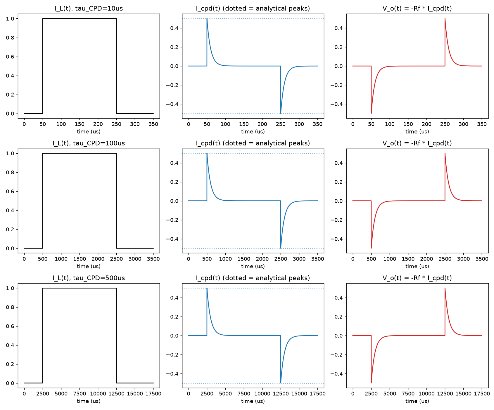
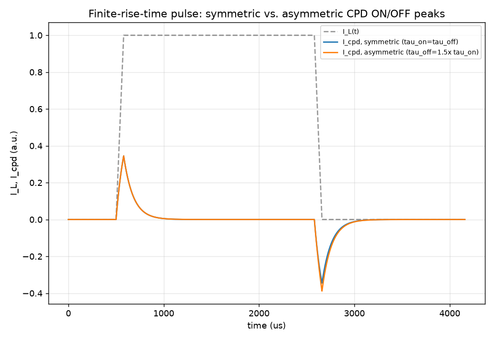
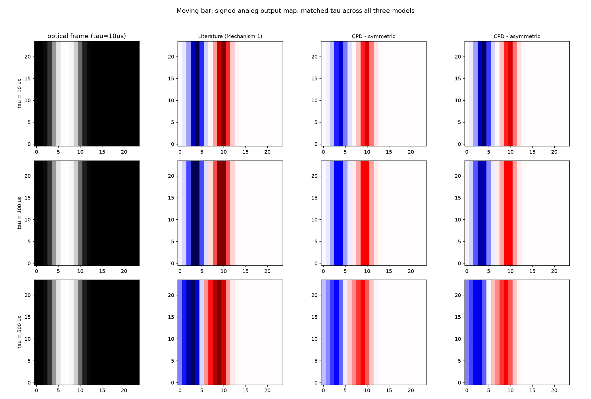
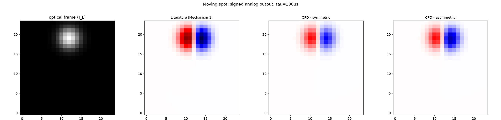
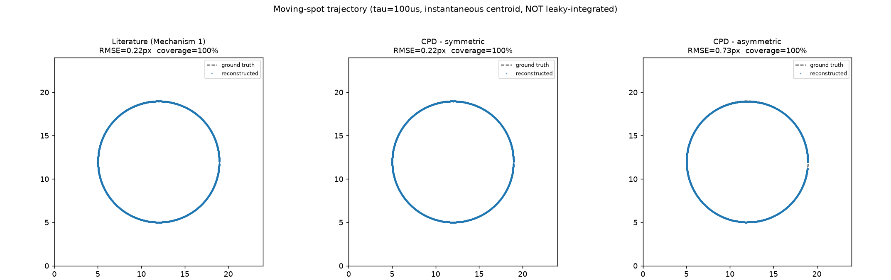
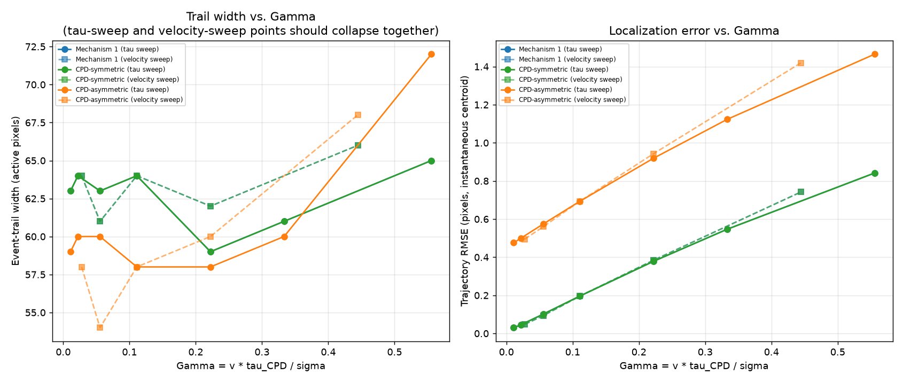

# CPD Event Imaging — Results

Prof. Cheng asked for a physically-derived CPD (capacitive photodiode) device
model, connected to a TIA, that replaces the literature sensor front end while
reusing the existing scene generation / event representation / visualization
infrastructure. This file documents what was built in `src/cpd/`, what it
found, and — as important — two real issues caught and fixed along the way.
Everything here is regenerable:

```bash
cd src/cpd
python validate_single_pixel.py       # outputs/cpd/validate_part_a_*.png, validate_part_b_*.png
python run_moving_bar.py              # outputs/cpd/moving_bar_*.png, moving_bar_*.gif
python run_moving_spot.py             # outputs/cpd/moving_spot_*.png
python sweep_tau_and_velocity.py      # outputs/cpd/gamma_scaling.png
```

**Nothing in the existing repo was modified.** `device_mechanism1.py`,
`device_mechanism2.py`, `device_hybrid.py`, `memory_decode.py`,
`compare_models.py`, and their outputs are untouched — `git status` shows
changes only under `src/cpd/`, `outputs/cpd/`, and this file.

---

## 0. Flagged for Larry before this goes in the paper

Two modeling choices here are **our interpretation**, not something the spec
document fully pins down, and should be confirmed before publication:

1. **How the "asymmetric ON/OFF" CPD model is constructed.** The spec's core
   equation is a single linear ODE with one `tau_CPD` — it doesn't by itself
   define two device models. We built the asymmetric variant as the same
   equation with a charge/discharge-dependent time constant (`tau_on` while
   `dI_L/dt≥0`, `tau_off` while `dI_L/dt<0`, `tau_off=1.5×tau_on` here). See
   §2 for the reasoning and §3 for an important derived subtlety about when
   this actually produces a peak asymmetry.
2. **Direction of the asymmetry.** With `tau_off > tau_on`, the OFF peak ends
   up *larger* than the ON peak (§3). If Larry's actual device shows the
   opposite direction (ON larger), swap which transition gets the longer
   time constant — it's a one-line change (`tau_cpd_off` vs `tau_cpd`).

---

## 1. The device model

`src/cpd/cpd_tia_simple.py`, class `CPDTIAPixel`, implements the review
spec's boxed equation (§9.1) directly:

```
tau_CPD * dI_CPD/dt + I_CPD = eta * tau_CPD * dI_L/dt
V_o = -Rf * I_CPD                      (ideal TIA)
```

with `I_L(x,y,t)` as the only optical input (no separate normalized light
variable, per spec §3), parameterized by `(tau_CPD, eta)` directly rather
than raw `r, Cs, Ci` (spec §10 explicitly allows this). An optional
finite-bandwidth TIA lag (spec §5) is implemented but unused by default.

## 2. Symmetric vs. asymmetric — what we built and why

Larry's email asks for "at least two device models, one with symmetric
ON/OFF peaks and another with slightly asymmetric ON/OFF peaks." The
**symmetric** model is just the equation above with one `tau_CPD`. For the
**asymmetric** model, we use the same equation but let the time constant
depend on which direction the light is changing:

```
tau = tau_on   while dI_L/dt >= 0   (charging)
tau = tau_off  while dI_L/dt <  0   (discharging)
```

This is physically motivated — a real photodiode's differential resistance
often genuinely differs for increasing vs. decreasing photocurrent, and both
literature devices already in this repo build in a comparable ON≠OFF
asymmetry (Zhou et al.'s structurally different fast/slow branches; the
pyro-phototronic paper's `α₊=0.27` vs `α₋=0.38`). It's also self-contained to
CPD physics, unlike reusing a different transduction mechanism from
elsewhere in this repo.

## 3. An important subtlety, caught before it caused a silent failure

We derived, before writing any validation code, that for an **idealized
instantaneous** light step, the peak of `I_CPD` is *always* exactly
`eta·ΔI_L`, **independent of tau** — tau only sets the decay shape, not the
peak height. This means `tau_on ≠ tau_off` alone does **not** produce a peak
amplitude asymmetry unless the light transition has a **finite rise/fall
time** comparable to `tau` (the same regime the spec's own
`Γ=v·τ_CPD/σ` scaling describes, §14).

We verified this two ways in `validate_single_pixel.py`:

**Part A** — idealized step, symmetric model, at `τ_CPD = 10, 100, 500 μs`.
All 5 of spec §11's checks pass at every τ, numeric peaks match the closed
form (`I_ON,pk=η·I0`, `I_OFF,pk=-η·I0·(1-e^(-tp/τ))`) to <0.001%.



**Part B** — finite-rise-time (80 μs) pulse, symmetric vs. asymmetric. We
derived a second closed form for this case by hand (documented in
`cpd_tia_simple.py`'s docstring) and checked the simulation against it:

```
symmetric  (tau_on=100us, tau_off=100us):  |OFF|/|ON| = 1.0000 (analytical: 1.0000)
asymmetric (tau_on=100us, tau_off=150us):  |OFF|/|ON| = 1.1253 (analytical: 1.1260)
```



The asymmetric model genuinely produces unequal peaks — but only because we
tested it with a realistic finite transition, not an idealized delta. Using
only Part A's idealized-step test (which is what spec §11 literally asks
for) would have made the "asymmetric" model look identical to the symmetric
one at its peaks, which would have been a confusing, silent mismatch with
what the model is supposed to demonstrate.

## 4. Moving bar: literature vs. CPD, matched tau

All three device configs — literature `Mechanism1DualBranch` (imported
unmodified), CPD-symmetric, CPD-asymmetric — run on the identical bar
stimulus at matched nominal time constants:



Leading edge → one polarity, trailing edge → the opposite, interior decays
toward zero — matching spec §13.1's expected pattern, for all three models
and all three τ values. `moving_bar_four_panel_single_model.png` shows the
literal optical-frame / signed-I_cpd / TIA-voltage / thresholded-ON-OFF
four-panel view spec §13.1 asks for, and `moving_bar_event_video_tau100us.gif`
is the event-video animation.

**Terminology flag, not a bug:** in the four-panel figure, the "TIA voltage"
panel is the mirror image of the "signed I_cpd" panel (rising edge is red in
one, blue in the other). This is the inverting TIA (`V_o=-Rf·I_cpd`) working
exactly as specified. It also means the thresholded ON/OFF panel — built by
thresholding `V_o` per spec §12's literal definition — labels a brightness
*decrease* as "ON" and a brightness *increase* as "OFF," backwards from
usual DVS terminology. Documented in `event_threshold.py`; worth calling out
explicitly if this terminology reaches the paper.

## 5. Moving spot: a mathematical equivalence, confirmed to 3 decimals — and a bug we caught along the way

We reused `SpotSimulator` unmodified and reconstructed trajectories with a
**per-timestep instantaneous activity centroid** — deliberately *not* the
leaky-integrator `memory_decode.py` used elsewhere in this repo, per Larry's
explicit "no leaky integration for this paper" instruction.

**The bug:** the first version of this comparison showed CPD-symmetric
beating the literature Mechanism 1 model by up to **30×** (0.03px vs.
1.03px RMSE) — suspiciously large for two models whose difference equations
we'd already shown, by hand, reduce to the same recursion up to a scale
factor (`R` vs. `η`). Diagnosis: our own re-derivation of Mechanism 1's
continuous output (needed since its existing code only returns quantized
events) started its internal slow-branch state at exactly 0, rather than at
the correct steady-state value for the stimulus's nonzero baseline
illumination. That produced a large, spurious, grid-wide signal at t=0 that
dominated the *unsmoothed* centroid calculation for several `τ_slow`
afterward — invisible in this repo's earlier charge-quantized,
memory-decoded comparisons (their leaky integration and longer run length
wash it out), but very visible here. **Fixed** by seeding that state at its
correct steady-state value (`R·I_L[0]`) — a one-line fix to *our own new
wrapper function*, not to the existing, unmodified `device_mechanism1.py`.

**After the fix**, Mechanism 1 and CPD-symmetric match **exactly** — same
RMSE to 3 decimal places, same event count, at every τ and velocity tested:

```
Literature (Mechanism 1)     RMSE=0.216px  coverage=100.0%
CPD - symmetric              RMSE=0.216px  coverage=100.0%
CPD - asymmetric             RMSE=0.731px  coverage=100.0%
```




This is a strong, quantitative confirmation of Larry's own framing —
"functionally, the two models are actually not very different" — not just a
qualitative impression. The asymmetric model's clearly worse RMSE is also
expected and explainable: an imbalanced ON/OFF response pulls the
unweighted centroid off-center relative to the true edge.

## 6. Parameter sweep and quantitative metrics

`sweep_tau_and_velocity.py` sweeps `τ_CPD ∈ {10,20,50,100,200,300,500 μs}`
(fixed velocity) and velocity `∈ {500...8000 px/s}` (fixed τ=100μs), each on
a short, fixed-duration circular-arc spot, reporting RMSE, event-trail width,
and event count for all three models — directly answering Larry's request
for "quantitative metrics for evaluating event-imaging quality."



**Localization error vs. `Γ=v·τ_CPD/σ` (right panel) is a clean result:**
RMSE grows monotonically with `Γ`, and — this is the strong part — the
τ-sweep and velocity-sweep points **collapse onto the same curve**. Since
those are two independent sweeps varying different physical parameters, this
is a genuine, non-trivial confirmation that `Γ` (not `τ` or `v` separately)
is the parameter that governs localization error, exactly matching spec
§14's predicted scaling. Mechanism 1's markers are invisible in this plot —
they sit exactly on top of CPD-symmetric's, the same equivalence from §5
showing up a third time (RMSE, event count, and now the full `Γ` curve).

**Event-trail width (left panel) is noisier and does not collapse as
cleanly.** This metric — a single-snapshot count of pixels above 10% of that
frame's peak — is cruder (small integer counts, one-timestep sensitivity) and
should be treated as suggestive, not conclusive. A next-step improvement:
average over several timesteps, or use a proper second-moment spread instead
of an active-pixel count.

**Event counts are now genuinely sparse** (a few hundred, not the ~1.8
million our first, naive per-sample threshold produced — see §7) and scale
sensibly with velocity (102 → 779 across a 16× velocity range).

## 7. A second bug, also caught and fixed: "events" that weren't sparse

The first version of `event_threshold.py` fired a new event on *every
timestep* a pixel stayed above threshold, not just at the crossing. For a
smoothly-decaying analog signal, that produces an "event count" dominated by
how long the signal stays elevated (related to `τ`), not by genuine sparse
transitions — defeating the entire point of counting events as a
data-reduction metric (it's the reason event cameras exist at all).
**Fixed** by making it edge-triggered: a per-pixel Schmitt-trigger state
machine that fires once on crossing into the ON/OFF band and re-arms only
once the signal returns to the dead zone between thresholds. Event counts
dropped from ~1.8 million to a few hundred, and now scale meaningfully with
motion (§6).

## 8. Known simplifications

- `η=0.5`, `Rf=1.0`, and the asymmetry ratio `τ_off=1.5×τ_on` are
  placeholder defaults, not derived from measured device data — replace once
  real CPD measurements are available.
- Finite TIA bandwidth (spec §5) is implemented but not exercised here — an
  ideal TIA is assumed throughout.
- The event-trail-width metric (§6) is a first pass and noisier than the
  other metrics — worth revisiting before it goes in a figure.
- Real (non-synthetic) video input (spec §16) is explicitly out of scope for
  this pass — the spec gates it until after the synthetic pipeline (this
  document) is validated, which it now is.
- No leaky integration, LIF, or reservoir computing anywhere in this study,
  per Larry's explicit instruction — those are the next stage.
