# 10/28 Meeting Prep — Symmetric vs. asymmetric CPD response in event imaging and trajectory tracing

**For:** Prof. Larry Cheng, Tasnim &nbsp;·&nbsp; **From:** Meet Raval &nbsp;·&nbsp; **Repo:** `meetraval2006/sensing`, folder `src/cpd_trap/`

**The task:** use the provided device models, with a symmetric and an asymmetric ON/OFF response, to show the output of (1) a moving-object model and (2) uploaded videos. The task file is in [`docs/specs/CPD_event_imaging_trajectory_simulation_model.md`](docs/specs/CPD_event_imaging_trajectory_simulation_model.md).

---

## 0. One-minute summary

**What was done** (everything below runs from the code in `src/cpd_trap/`):

| Ask | Status | Where |
|---|---|---|
| Implement the device model exactly as given (box S with traps, box A without) | ✅ Done. **13/13 calibration numbers in the task file reproduce**; dt = 2 µs vs 1 µs agrees to < 0.1 pA | §3 |
| Moving object: Gaussian spot on 64×64, straight / right-angle turn / faster pass / reversal / repeated pass after 1, 3, 10, 30 ms dark | ✅ Done for all 12 models | §4 |
| Task A (4 circuit speeds), Task B (zero-trap control + 4 trap models), optional Eq. 6 controlled-ratio comparison | ✅ Done; same threshold and same tracker for every run | §4 |
| All metrics in the task table (event counts, detection fraction, latency, IoU, trajectory error, valid-trace fraction, reversal delay) | ✅ Done | `outputs/cpd_trap/summary_basic.md`, `summary_repeat.md` |
| Uploaded video → event video | ✅ Drop a clip in `videos/`, run one command. Shown on a synthetic traffic clip (known car positions) and a real freeway clip | §6 |
| Explain *why* a score is better or worse | ✅ Four mechanisms identified, each checked directly | §5 |

**Five findings in plain language**

1. **The Gaussian spot in the task file cannot show the device's asymmetry.** On the spot, every trap model gives |ON| ≥ OFF (ρ_G = 1.02–1.27), the *opposite* of the device behaviour (weaker ON, stronger OFF). The reason is that a σ = 2 px spot lights each pixel for only ~1 ms, too short for the traps to fill (τ_on = 0.8–2.9 ms). **On a flat-topped moving object that stays on a pixel for ≥ 2.5 ms, the same trap models give |ON|/OFF = 0.70, 0.58, 0.58**; with sharp edges they reach their square-pulse values (sq0.2 → 0.21). (§5.1, Fig. 5)
2. **A weaker ON tends to *improve* this tracker, not hurt it.** The CPD responds to the *rate of change* of light, so a symmetric pixel fires its ON event about 1 ms before the object arrives, and the traced position runs ~2 px *ahead* of the object. A weaker ON fires later and cancels part of that lead. On the flat-top object, error drops from 1.62 px (symmetric) to 1.13 px (strongest traps). This is a possible "advantage of the asymmetry" to discuss. (§5.2)
3. **The biggest failure is a threshold effect at the dim edge of the object, not the asymmetry itself.** For the sq0.7 trap model, pixels 4 px off the path get an ON peak of 4.55 nA and an OFF peak of 4.23 nA. The threshold θ = 4.5 nA sits between them, so the ON fires and the OFF never does, leaving permanent trails (error 10.8 px). (§5.3, Fig. 2)
4. **Traps give the sensor a memory of 10–30 ms.** When an object passes the same pixels twice, the second pass is different for up to ~30 ms of darkness (ON up to 15 % weaker, OFF up to 18 % stronger). The trap-free baseline forgets within ~3 ms. (§4.4)
5. **Video works and shows the asymmetry visually.** On real freeway footage the physical trap models fire 14–23 % fewer events, and an imposed 0.2 ratio wipes out every ON event. On our synthetic traffic clip the bright car follows the same trend as the spot (error 2.10 → 0.98 px). The task's tracker (ON sets a pixel, OFF clears it) fails for dark cars on a grey road, because a dark car fires OFF first. This is a property of the tracker, not the device. (§6)

---

## 1. Model key: which model is which

> Last meeting it was hard to tell the models apart. **In this round, every model comes from the task file.** No literature model (Mechanism 1 / 2 / Hybrid) and no AI-invented model is used. The summary figures, the scenario panels, the video snapshots and GIFs, and the video tables print the code label *and* a plain-English name; the table below decodes any code label you see elsewhere.

### 1a. The 12 models used in this round

All 12 share the same readout circuit (box A or S), the same 3 µA peak photocurrent, the same threshold θ = 4.5 nA and the same tracker. Only the parameters in the middle columns change.

| Code label (in figures) | Plain-English name | Equations | Circuit τ₁ / τ₂ | Traps τ_on / τ_off | ρ_sq (square pulse) | ρ_G (Gaussian pass) | Role |
|---|---|---|---|---|---|---|---|
| `A-fast` | No traps, fast circuit | box A | 50 / 10 µs | — | — | 1.000 | Task A |
| **`A-reference`** | **No traps, reference circuit = SYMMETRIC BASELINE** | box A | 150 / 20 µs | — | **1.000** | **1.004** | Task A **and** Task B zero-trap control |
| `A-slow` | No traps, slow circuit | box A | 400 / 40 µs | — | — | 1.047 | Task A |
| `A-very-slow` | No traps, very slow circuit | box A | 1200 / 100 µs | — | — | 1.334 | Task A |
| `B-trap-sq1.0` | Traps, square-pulse ON/OFF 0.99 (weakest) | box S | 150 / 20 µs | 2.899 / 3.184 ms | 0.993 | 1.124 | Task B, **physical asymmetry** |
| `B-trap-sq0.7` | Traps, square-pulse ON/OFF 0.70 | box S | 150 / 20 µs | 1.858 / 13.058 ms | 0.695 | 1.017 | Task B, **physical asymmetry** |
| `B-trap-sq0.5` | Traps, square-pulse ON/OFF 0.50 | box S | 150 / 20 µs | 1.351 / 16.967 ms | 0.496 | 1.052 | Task B, **physical asymmetry** |
| `B-trap-sq0.2` | Traps, square-pulse ON/OFF 0.20 (strongest) | box S | 150 / 20 µs | 0.829 / 8.786 ms | 0.198 | 1.266 | Task B, **physical asymmetry** |
| `ctrl-1` | Imposed ON scale 1.0 (= baseline) | `A-reference` output, Eq. 6 | 150 / 20 µs | — | — | 1.000 | Eq. 6 control |
| `ctrl-0.7` | Imposed ON scale 0.7 | Eq. 6 | 150 / 20 µs | — | — | 0.700 | Eq. 6 control |
| `ctrl-0.5` | Imposed ON scale 0.5 | Eq. 6 | 150 / 20 µs | — | — | 0.500 | Eq. 6 control |
| `ctrl-0.2` | Imposed ON scale 0.2 | Eq. 6 | 150 / 20 µs | — | — | 0.200 | Eq. 6 control |

How to read the families (the same colours are used in every summary figure):

- 🔵 **Task A (`A-…`)**: no traps. ON and OFF are symmetric in the device sense. Slow circuits still show *electrical* lopsidedness on the moving spot (ρ_G up to 1.33), and the task file asks us not to call that trap asymmetry.
- 🟠 **Task B (`B-trap-…`)**: Prof. Cheng's trap model. Traps capture charge while the light is on (weaker ON) and release it in the dark (stronger OFF). The label number is the **square-pulse** ratio the parameters were calibrated to, *not* the ratio the moving spot sees.
- 🟢 **Control (`ctrl-…`)**: the symmetric baseline current with only its ON (negative) lobe multiplied by ρ*/1.004 (Eq. 6). It is **not physics**; it isolates "what does a given ON/OFF ratio do to tracking?"

Two ratios appear everywhere:

- **ρ_sq** = |ON| / OFF for a 2.5 ms ideal square light pulse. This is the calibration label.
- **ρ_G** = |ON| / OFF for one Gaussian-spot pass through a pixel centre. This is what the moving spot actually sees.
- Panels also print **"|ON|/OFF on this input"**, measured for that scenario. For the flat-top disk this differs a lot from ρ_G.

### 1b. The tracker (fixed for every model, as discussed last time)

**One tracker for every run:** the task file's event-state map. An ON event sets its pixel to 1, an OFF event resets it to 0, and the traced position is the centroid of the pixels set to 1. There is no leaky integration and no tuning per model. Only the device model changes between runs.

Event rule: ON = first crossing of i_R below −4.5 nA in a pixel passage; OFF = first crossing above +4.5 nA. At most one event of each polarity per passage. Rising light gives negative i_R (ON), falling light gives positive i_R (OFF), matching the device: negative pulse at light-on, positive at light-off.

### 1c. Models in the repo from earlier rounds — **not used in this round**

| Name | Where | What it was | Status |
|---|---|---|---|
| Mechanism 1 (WSe₂ dual-branch) | `src/device_mechanism1.py` | Zhou et al., *Nat. Electron.* 2023 | Earlier round, literature baseline |
| Mechanism 2 (pyro-phototronic) | `src/device_mechanism2.py` | Li et al., *InfoMat* 2025 | Earlier round, literature baseline |
| Hybrid v3 | `src/device_hybrid.py` | our construction mixing 1 and 2 | Earlier round; did not beat Mechanism 1 |
| "CPD-symmetric" | `src/cpd/` | first-order CPD→TIA model from the earlier review file | Earlier round |
| "CPD-asymmetric" | `src/cpd/` | **our own guess** (τ switches with the sign of dI/dt). Not from Prof. Cheng | **Superseded** by the trap model (box S) in this round |

### 1d. What we added that is *not* in the task file (each is labelled where it appears)

| Addition | Why | Effect on the results |
|---|---|---|
| Flat-top **disk** scenario (radius 5 px, sharp edge) | The Gaussian spot cannot show the device asymmetry (finding 1) | Extra scenario only; the Gaussian runs are unchanged |
| Event re-arm at θ/2 | Implements "one event per polarity per passage" without counting tiny wiggles | None in practice: the circuit response has no ringing |
| RK4 integrator, dt = 2 µs | Numerical method; checked against dt = 1 µs | < 0.1 pA |
| Video: 1 frame = 1 ms of sensor time, linear interpolation between frames, 30 ms hold of frame 0 | A video frame interval is not a sensor time (§6) | Video only |
| Video: a second "bipolar" tracker | Handles dark objects (fires OFF first) | Reported **next to** the task-file tracker, never instead of it |

---

## 2. Answers to questions from the last meeting

**"What algorithm turns the events into the trajectory?"**
*Last round* (`src/cpd/run_moving_spot.py`): the centroid of |signal| in each frame. *This round*: the task file's event-state map (§1b), the same for every model.

**"What was the bug?"**
It was **in our own code, not in the Zhou et al. paper.** Last time I said it was in the paper; that was wrong. Our wrapper that recomputed Mechanism 1's continuous output started its slow branch at 0 instead of at steady state, which created a fake grid-wide signal at t = 0. Fixing one line in the wrapper made Mechanism 1 and CPD-symmetric agree exactly. `device_mechanism1.py` itself was never wrong.

**"Is the rise to the peak really instantaneous (Part A)?"**
In last round's first-order model, yes: the response jumps to η·ΔI_L the instant the light steps, which is unphysical, as you suspected. **The model in this round fixes that.** The readout is second order (τ₁, τ₂), so even for an ideal light step i_R starts at zero and rises smoothly, peaking at t* = ln(τ₁/τ₂)/(1/τ₂ − 1/τ₁) ≈ **46.5 µs** for the reference circuit. You can see this in the square-pulse curves in §3.

**"Is the code really using the model I gave?"**
Yes. `validate_single_pixel.py` prints every number in the task file's calibration table next to our result with PASS/FAIL, and **all 13 pass** (§3). That check is the guard against the AI quietly substituting a different model.

**"Schmitt trigger?"**
That was AI wording for "a comparator with a dead band so one threshold crossing gives one event". This round uses the task file's rule (§1b).

---

## 3. Step-by-step: what the simulator does

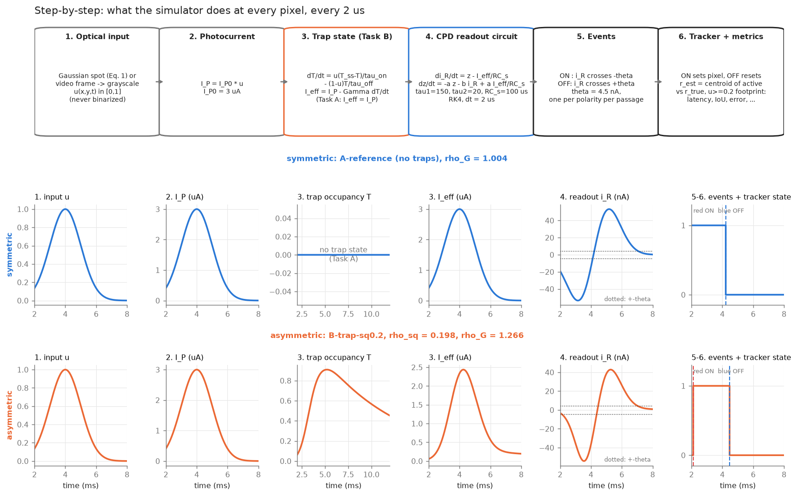

*Top: the six steps run at every pixel every 2 µs. Bottom: the actual signals at one pixel during one Gaussian pass, for the symmetric baseline (blue) and the strongest trap model (orange). The trap state T rises while the spot is on and drains slowly afterwards. I_eff is therefore pulled down on the rising side and held up on the falling side, and the readout i_R (step 4) crosses ±θ to produce the ON/OFF events that drive the tracker (steps 5–6).*

### Model check against the task file (13/13 PASS)

`python src/cpd_trap/validate_single_pixel.py` → [`outputs/cpd_trap/single_pixel_summary.txt`](outputs/cpd_trap/single_pixel_summary.txt)

| Model | Square ON peak (ours / task file) | Square OFF peak (ours / task file) | ρ_sq | ρ_G (ours / task file) |
|---|---|---|---|---|
| zero-trap (`A-reference`) | −0.44006 / −0.44007 µA | 0.44006 / 0.44007 µA | 1.000 | 1.004 / 1.004 |
| `B-trap-sq1.0` | −0.32004 / −0.32007 | 0.32240 / 0.32241 | 0.993 | 1.124 / 1.12 |
| `B-trap-sq0.7` | −0.25413 / −0.25413 | 0.36590 / 0.36591 | 0.695 | 1.017 / 1.02 |
| `B-trap-sq0.5` | −0.18636 / −0.18636 | 0.37583 / 0.37584 | 0.496 | 1.052 / 1.05 |
| `B-trap-sq0.2` | −0.07458 / −0.07458 | 0.37604 / 0.37605 | 0.198 | 1.266 / 1.27 |
| `A-fast`, `A-slow`, `A-very-slow` | — | — | — | 1.000, 1.047, 1.334 / same |

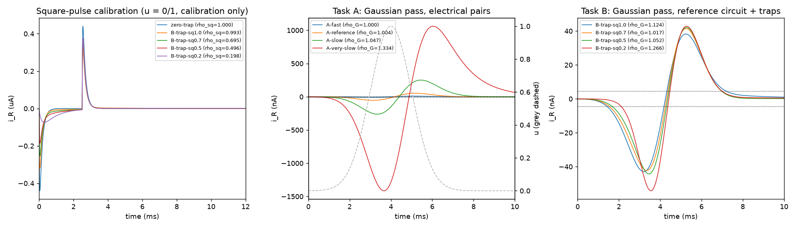

*Left: square-pulse calibration (u = 0/1 for calibration only). Middle and right: one Gaussian pass. The weakest response (`A-fast`) peaks at 9.1 nA, about 2× the 4.5 nA threshold, as the task file warns.*

---

## 4. Moving-object model (Gaussian spot, as specified)

Spot: σ = 2 px on 64×64, starting and ending ≥ 4σ off the array, then 5 ms of darkness. Speeds are 2 px/ms (straight, turn, reversal) and 8 px/ms (fast).

### 4.1 What the event images look like

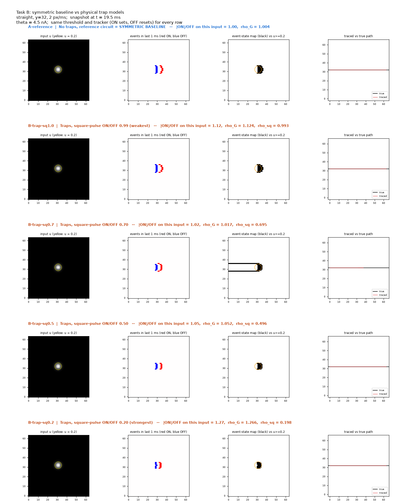

*Each row is one model, named in its header. Columns: input u; events from the last 1 ms (**red = ON** at the leading edge, **blue = OFF** at the trailing edge); event-state map (black) against the true u ≥ 0.2 footprint (orange); traced vs true path. In the `B-trap-sq0.7` row, the two black lines running back along the path are the trails from finding 3.*

Movie (the same four models side by side):

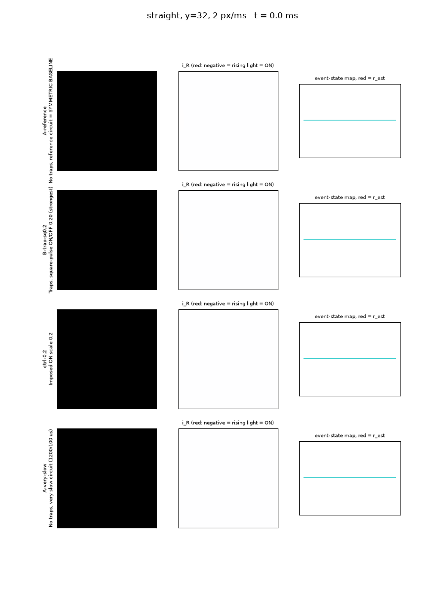

More: `outputs/cpd_trap/<scenario>/panels_taskA.png`, `panels_taskB.png`, `panels_control.png`, `pixel_traces_*.png` for `straight`, `turn`, `fast`, `reversal`, `disk`, plus `movie_turn.gif`.

### 4.2 Symmetric vs. asymmetric, straight Gaussian pass

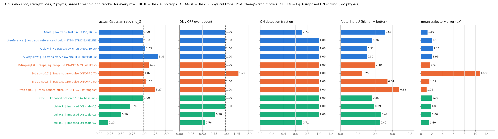

| Model | ρ_G | ON / OFF events | ON detection | IoU | Mean error (px) | What is going on |
|---|---|---|---|---|---|---|
| `A-reference` (symmetric baseline) | 1.004 | 576 / 576 | 1.00 | 0.36 | 1.96 | traced position leads the spot by ~1.9 px |
| `A-fast` | 1.000 | 320 / 320 | 0.71 | 0.51 | 1.19 | weak signal: the outer rows never cross θ |
| `A-very-slow` | 1.334 | 832 / 832 | 1.00 | 0.30 | 1.99 | broad, early ON events |
| `B-trap-sq1.0` | 1.124 | 576 / 576 | 1.00 | 0.40 | 1.67 | |
| `B-trap-sq0.7` | 1.017 | 576 / **448** | 1.00 | 0.25 | **10.85** | outer rows: ON fires, OFF never does → trails (§5.3) |
| `B-trap-sq0.5` | 1.052 | 448 / 448 | 1.00 | 0.54 | 1.57 | |
| `B-trap-sq0.2` | 1.266 | 448 / 448 | 1.00 | **0.68** | **1.01** | ON delayed by the traps → smaller lead |
| `ctrl-0.7` | 0.700 | 576 / 576 | 1.00 | 0.39 | 1.80 | |
| `ctrl-0.5` | 0.500 | 448 / 576 | 1.00 | 0.47 | 1.86 | ON lost in the outer rows |
| `ctrl-0.2` | 0.200 | 320 / 576 | **0.71** | 0.45 | 1.49 | holes: ON missing in 2 of 7 rows of the footprint |

Latencies (event time minus the u = 0.2 crossing): the symmetric baseline fires ON a median **−990 µs** (before the spot's footprint arrives) and OFF **−1236 µs** (before it leaves). `B-trap-sq0.2` fires ON at −116 µs. Full table: [`outputs/cpd_trap/summary_basic.md`](outputs/cpd_trap/summary_basic.md).

### 4.3 Every model × every path

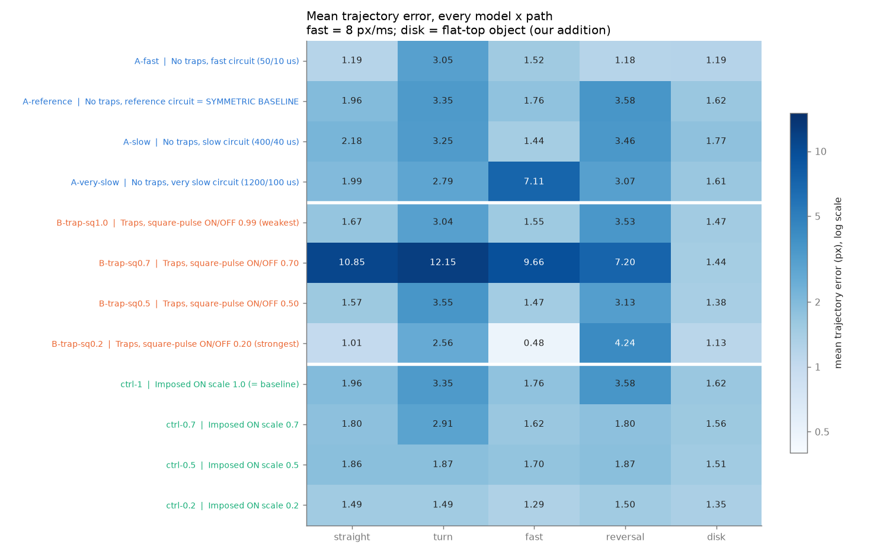

- **Turn:** errors are larger than on the straight path (2.6–3.6 px for most models; `ctrl-0.5` and `ctrl-0.2` stay at ~1.5–1.9 px). The error has not yet been split into before / at / after the corner, so the cause is not pinned down.
- **Fast (8 px/ms):** `A-very-slow` breaks down (7.1 px; 960 ON vs 832 OFF, i.e. two rows of ON with no OFF). This is consistent with its 1.2 ms circuit being too slow for a spot that crosses a pixel in 0.25 ms: the two lobes overlap and OFF ends up below θ at the edge of the spot. `B-trap-sq0.2` is best (0.48 px).
- **Reversal:** the traced reversal comes ~100 µs *before* the true one for most models, because of the same lead. The slow circuits come late: `A-slow` +26 µs, `A-very-slow` +126 µs.
- `B-trap-sq0.7` is worst on every Gaussian path (finding 3), but fine on the disk (1.44 px), where no pixel sits near the threshold.

### 4.4 Repeated pass after 1, 3, 10, 30 ms of darkness (traps never reset)

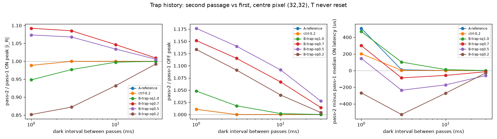

*Centre pixel, second pass relative to first; one line per model (see legend). For the four `B-trap-…` models the second pass differs for up to ~30 ms of darkness: ON is weaker by up to 15 % (`B-trap-sq0.2`) and OFF stronger by up to 18 % (`B-trap-sq0.5`). `A-reference` and `ctrl-0.2` (no trap state) only differ at 1 ms, from electrical overlap, and are back to 1.00 by 3 ms. Table: [`outputs/cpd_trap/summary_repeat.md`](outputs/cpd_trap/summary_repeat.md).*

---

## 5. Why a score is better or worse (interpretation)

### 5.1 The device asymmetry needs dwell time, and the σ = 2 spot is too brief

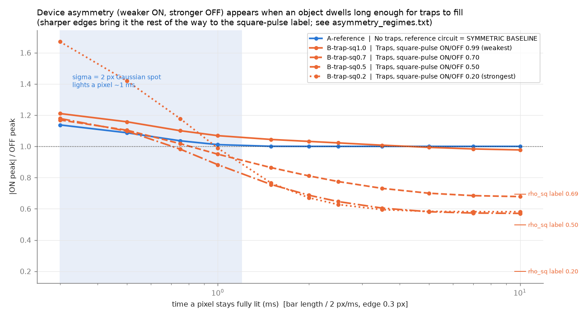

*|ON|/OFF at one pixel as a soft-edged bar moves past at 2 px/ms; the x-axis is how long the pixel stays fully lit. At 0.5 ms every trap model gives a ratio above 1 (1.10–1.42). Around 1 ms they cross 1. From ~2.5 ms upward they settle well below 1: sq0.7 → 0.70, sq0.5 → 0.58, sq0.2 → 0.58 (short ticks on the right are the square-pulse labels). The Gaussian spot (shaded) has no flat top at all: its brightness peaks for an instant, so it behaves like the short-dwell end.*

**Edge sharpness is the second condition.** With a 0.3 px edge (a ~150 µs ramp), the strongest trap model stops at 0.58. Sharpening the edge brings every model to within ~0.07 of its label (10 ms dwell; a 10 ms dwell fills the traps slightly more than the 2.5 ms calibration pulse, so sq0.7 and sq0.5 end a little *below* their labels):

| Model | ρ_sq label | edge 0.3 px | edge 0.1 px | edge 0.03 px |
|---|---|---|---|---|
| `B-trap-sq1.0` | 0.993 | 0.977 | 0.972 | 0.970 |
| `B-trap-sq0.7` | 0.695 | 0.678 | 0.637 | 0.621 |
| `B-trap-sq0.5` | 0.496 | 0.571 | 0.485 | 0.454 |
| `B-trap-sq0.2` | 0.198 | 0.581 | 0.312 | **0.208** |

So the device asymmetry shows up fully when an object stays on a pixel for ≳ 2.5 ms **and** its edges are sharp compared with the circuit's response (~100–150 µs). The square-pulse calibration meets both conditions; the σ = 2 Gaussian meets neither.

- **Physical picture (matches your description):** under light, part of the photocurrent fills traps instead of charging the capacitor, so ON is weaker. In the dark, the trapped charge and the capacitor charge come out together, so OFF is stronger. The traps need roughly τ_on of illumination to fill. The Gaussian spot illuminates a pixel for ~1 ms, so they barely fill. Our reading of the Fig. 1 waveforms is that what is left is mostly the slow release (the tail of I_eff), which spreads the OFF lobe out in time and makes its peak *lower*.
- **Speeding the spot up does not help.** We checked: at 32 px/ms all models, including the symmetric baseline, reach ρ ≈ 1.8–2.5, because the two electrical lobes overlap. The numbers are in [`outputs/cpd_trap/meeting/asymmetry_regimes.txt`](outputs/cpd_trap/meeting/asymmetry_regimes.txt).
- **Consequence:** to *demonstrate* the device's asymmetry in a moving-object result, the object needs a flat top. That is why the **disk** scenario was added (our addition, clearly labelled):

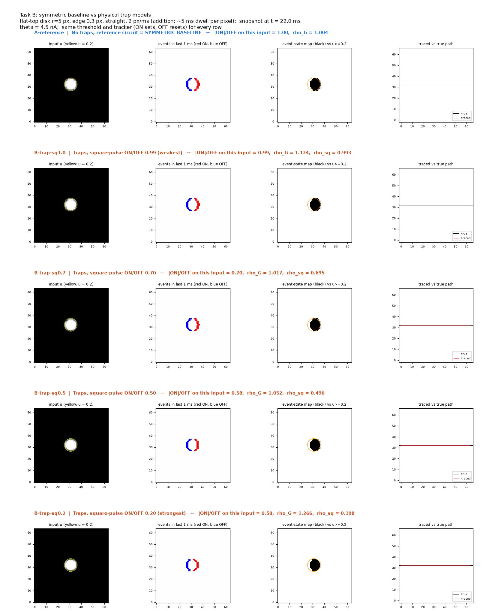

| Flat-top disk (r = 5 px, ~5 ms dwell) | |ON|/OFF on this input | ON latency (median) | IoU | Mean error (px) |
|---|---|---|---|---|
| `A-reference` (symmetric baseline) | 1.00 | −458 µs | 0.66 | 1.62 |
| `B-trap-sq1.0` | 0.99 | −404 µs | 0.70 | 1.47 |
| `B-trap-sq0.7` | **0.70** | −360 µs | 0.71 | 1.44 |
| `B-trap-sq0.5` | **0.58** | −300 µs | 0.73 | 1.38 |
| `B-trap-sq0.2` | **0.58** | −16 µs | 0.79 | 1.13 |
| `ctrl-0.7` | 0.70 | −394 µs | 0.67 | 1.56 |
| `ctrl-0.5` | 0.50 | −334 µs | 0.69 | 1.51 |
| `ctrl-0.2` | 0.20 | −158 µs | 0.72 | 1.35 |

On the disk, the physical trap models and the imposed-ratio controls move **in the same direction**, so the Eq. 6 control is a fair proxy here. No model produces trails on the disk: every ON and OFF is detected.

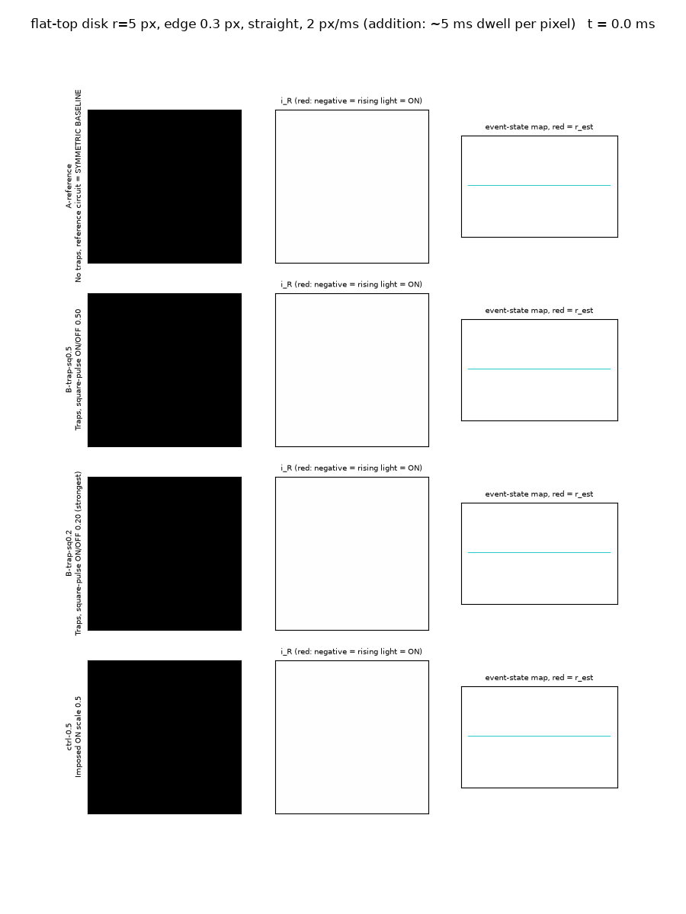

### 5.2 Lead bias: why a weaker ON can *lower* the error

The CPD responds to the *rate of change* of light, so ON fires on the leading tail of the object and OFF fires before the object has fully left. The event-state map is therefore shifted forward. On the straight Gaussian pass, the traced position sits ahead of the true centre by **+1.94 px** for the symmetric baseline, **+1.49 px** for `ctrl-0.2` and **+0.95 px** for `B-trap-sq0.2`, with **zero** sideways error in all three. A weaker or later ON shrinks that lead. A constant lead could also be calibrated out (about speed × 1 ms), which should be kept in mind before calling the asymmetry an advantage.

### 5.3 Threshold at the dim edge: the sq0.7 failure

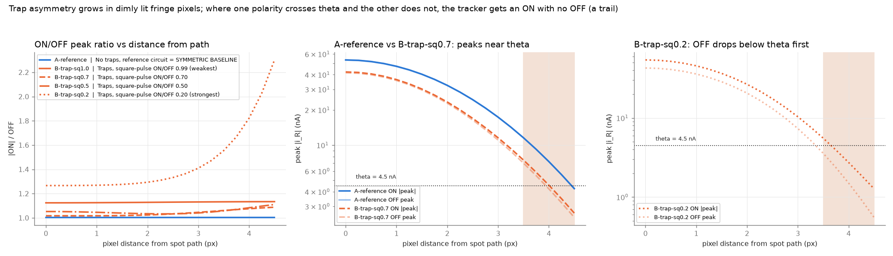

*Pixels farther from the path see a dimmer spot. For `B-trap-sq0.7`, the pixels 4 px off the path have ON = 4.55 nA and OFF = 4.23 nA, on either side of θ = 4.5 nA. Those two rows get an ON with no OFF and stay "on" forever, producing two trails and the 10.8 px error. For `B-trap-sq0.2`, the asymmetry grows from 1.27 at the centre to 1.82 at the edge.*

This is a **threshold-placement** effect, so it is sensitive to θ. The task file notes that 4.5 nA is a noiseless demonstration value.

### 5.4 Circuit speed vs. object speed

With a slow circuit on a fast object (`A-very-slow` at 8 px/ms), the ON and OFF lobes overlap, and two rows at the edge of the spot get ON with no OFF. That produces trails and a 7.1 px error. This is purely electrical: no traps are involved. The per-row peaks have not been plotted for this case yet, so the lobe-overlap explanation is inferred from the event counts and from the ρ-vs-speed table.

---

## 6. Uploaded videos → event videos

### 6.1 How to run it

```bash
# put any clip (.mp4 .avi .mov .mkv .webm .ogv) in videos/, then:
cd src/cpd_trap
python run_video_folder.py           # every clip in videos/
python run_video_folder.py traffic   # only clips whose name contains "traffic"
```

Each clip is run with the **symmetric baseline** (`A-reference`), two **physical trap models** (`B-trap-sq0.5`, `B-trap-sq0.2`) and the **imposed 0.2 control** (`ctrl-0.2`). Each run writes `outputs/cpd_trap/video/<clip>/`: a snapshot sheet (PNG), the event video (GIF), event rates, and a summary table. An optional `videos/<clip>.json` sets crop, resolution, a ground-truth file, or `"stabilize": true` (recommended for real footage with camera motion, §6.3).

- **Pipeline:** frame → grayscale u ∈ [0, 1] (not binarized) → resize → linear interpolation between frames on the 2 µs grid → the same box A / box S models → the same ±4.5 nA events → the same tracker.
- **Time scale:** one video frame is mapped to 1 ms of sensor time, i.e. a 30 fps clip replayed ~33× faster than real time. At real-time speed most changes are too slow to cross θ (§6.4). The motion between frames is an assumed linear interpolation, not recovered sub-frame motion.

### 6.2 Synthetic traffic clip (our own, car positions known)

A bright car drives left → right; then a dark car drives right → left and changes lanes. The clip and its truth file are in `videos/`.

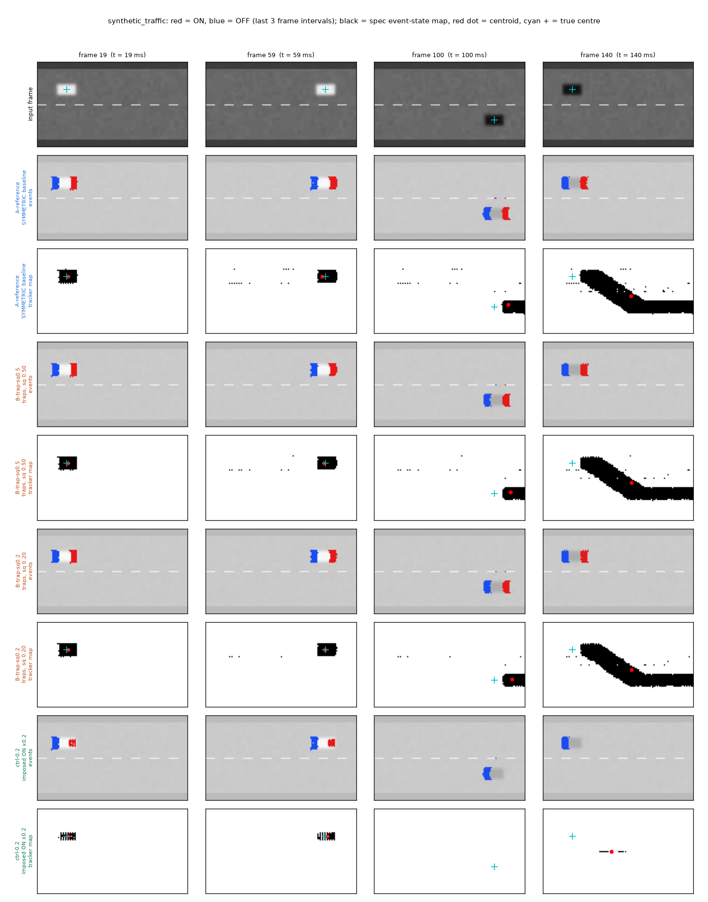

*Rows: input frame, then for each model its events (red ON / blue OFF) and its tracker map (black; red dot = traced position, cyan + = true centre). Bright car: red at the front, blue at the back. Dark car: reversed, because the road darkens at its front and brightens behind it.*

| Model | Bright car error (px) | Dark car error (px), task tracker | Dark car error (px), bipolar tracker | ON / OFF events |
|---|---|---|---|---|
| `A-reference` (symmetric baseline) | 2.10 | 36.4 | 10.6 | 3223 / 3224 |
| `B-trap-sq0.5` | 1.38 | 36.4 | 9.8 | 3162 / 3182 |
| `B-trap-sq0.2` | **0.98** | 37.1 | 9.8 | 3123 / 3133 |
| `ctrl-0.2` (imposed, not physics) | 0.90 | 30.3 (tracked only 49 % of the time) | 34.1 | 699 / 3224 |

- **Bright car:** the same trend as the spot and the disk. A weaker ON gives a smaller lead and a lower error (2.10 → 0.98 px).
- **Dark car:** the task tracker leaves a trail. The road behind a dark car brightens, which fires ON with no later OFF. The bipolar tracker cuts the dark-car error from ~36 px to ~10 px for the physical models, but fails for `ctrl-0.2`, which has almost no ON events left to clear the pixels.
- **The bipolar tracker is not a free win:** on the bright car it is *worse* than the task tracker (4.02 / 2.61 / 1.11 px for symmetric / sq0.5 / sq0.2, vs 2.10 / 1.38 / 0.98). This is why the task tracker stays the primary result everywhere.

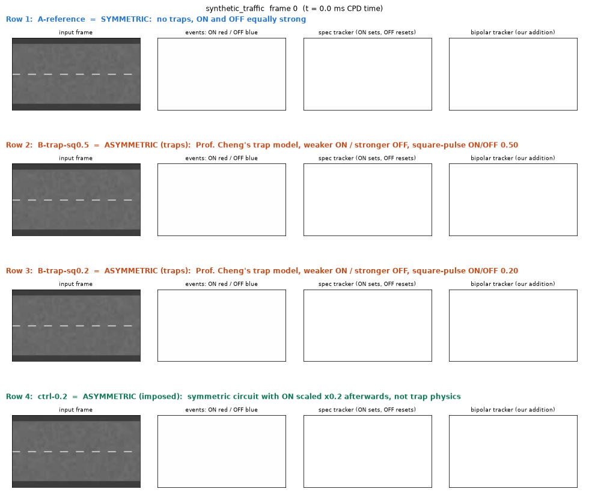

### 6.3 Real freeway footage

Ayalon Freeway, Tel Aviv. "Ayalon Freeway Azriely Towers View P1150162" by Deror avi, Wikimedia Commons, CC BY-SA 3.0. Cropped to the right-hand carriageway, 160×90 px, 150 frames.

The raw clip contains **camera shake**: 21 % of pixels change by more than 0.03 between frames, so building edges and lane markings fire everywhere (188,689 events, `outputs/cpd_trap/video/ayalon_freeway/`). A fixed sensor would not see that, so the main run **removes the global shake first** (phase-correlation registration, `--stabilize`; this is preprocessing, not part of the device model). That drops the changing pixels to 1.7 %, and the events now follow the cars:

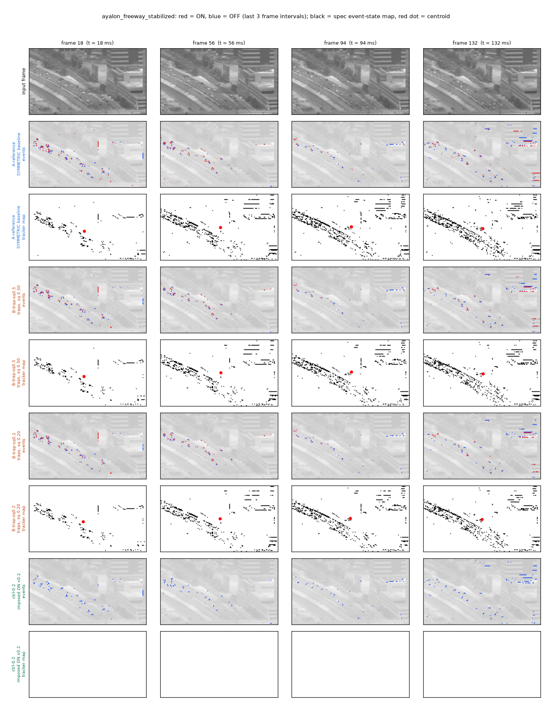

| Model (stabilized freeway) | ON | OFF | ON / OFF count | Pixels active in tracker map (mean) |
|---|---|---|---|---|
| `A-reference` (symmetric baseline) | 3489 | 3505 | 0.995 | 593 |
| `B-trap-sq0.5` | 2944 | 3027 | 0.973 | 514 |
| `B-trap-sq0.2` | 2703 | 2777 | 0.973 | 482 |
| `ctrl-0.2` (imposed, not physics) | **0** | 3505 | 0 | 0 |

- **Physical traps fire 14–23 % fewer events** than the symmetric baseline on real footage: ON drops by 16 % (sq0.5) and 23 % (sq0.2), OFF by 14 % and 21 %.
- **The imposed 0.2 ratio loses every ON event.** The cars are only 2–3 px at this scale and every car's ON peak is below 5θ (22.5 nA) in the symmetric model, so scaling them by 0.2 puts all of them below θ. Only blue OFF events remain, and the tracker map stays empty. This is the clearest visual demonstration of what an ON/OFF imbalance does to an event video.
- The task tracker accumulates trails along the lane: small cars produce ON-without-OFF pixels, as in §5.3. For a presentation the event video (middle rows) is the useful output, as you suggested.

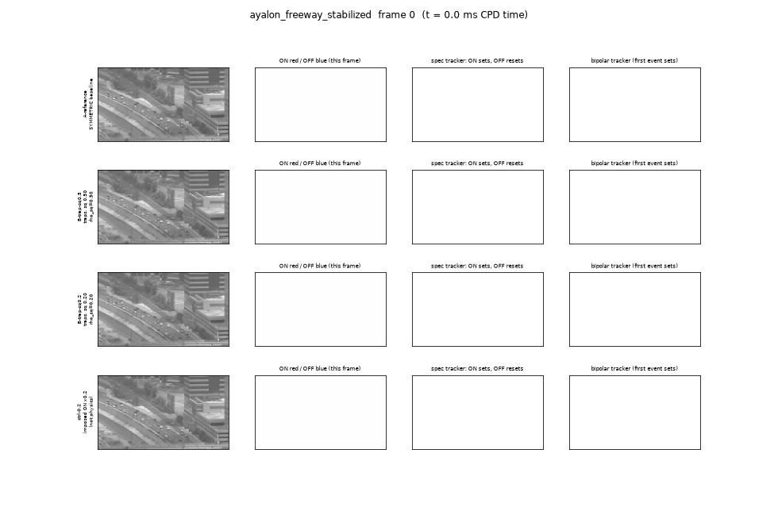

### 6.4 Why not real-time playback?

Playing the same clip at its true speed (1 frame = 33.3 ms; 30 frames at 80×45 px to keep the run short, no stabilization) produces **zero events** for the symmetric baseline (`outputs/cpd_trap/video/ayalon_freeway_realtime/`), even with the camera motion left in. The readout is a band-pass: for slow changes, i_R ≈ −(τ₁τ₂/RC_s)·dI/dt = −30 µs × dI/dt, so even a full 0 → 1 brightness change spread over one 33 ms frame gives only ~3 nA, below θ = 4.5 nA. The sensor needs changes on its own (sub-millisecond) time scale, hence the 1 frame = 1 ms mapping. This should be stated in the paper as an assumed playback speed.

### 6.5 A standard test video (your question from last meeting)

The closest thing to a "standard image" for event cameras is the **Event Camera Dataset** (Mueggler et al., *IJRR* 2017, RPG / University of Zurich). It has grayscale frames *and* real DAVIS events from the same sensor, so a simulated event video can be compared against real events. Its `shapes_6dof` sequences (simple black shapes on white) are ideal for showing ON/OFF asymmetry. A moving car or a flying bird from a free stock site also works for a presentation, and the pipeline above takes any clip unchanged.

---

## 7. Suggested discussion points

1. **Which input should the paper use to show the asymmetry?** The Gaussian spot in the task file cannot show |ON| < OFF (finding 1). Options: (a) a flat-top object, as in our disk; (b) re-fit τ_on / τ_off on the Gaussian, as the task file suggests, though fixed Γ and T_ss may not reach the targets; (c) present the Eq. 6 control as the "what if" result and the trap models as the physics.
2. **Is the lead reduction (§5.2) a real advantage?** It is specific to this tracker and could also be calibrated out. Worth deciding how to frame it in the paper.
3. **Threshold.** The sq0.7 failure sits within 0.3 nA of θ. Should θ come from a measured noise floor before these numbers go into the paper?
4. **Tracker for video.** The task-file tracker assumes bright objects. For traffic footage, should the paper use the polarity-agnostic variant, or only show event videos with no tracking? You mentioned video is mainly for visual impression.
5. **Real device model.** When the full (non-simplified) model is ready, `cpd_trap_model.py` is the only file that needs to change. Every scenario, video and figure reruns from the same scripts.

## 8. Action items

- [ ] **Meet:** add Prof. Cheng as a GitHub collaborator (school email) so he can edit Markdown here directly (*Settings → Collaborators → Add people*).
- [ ] Decide on discussion point 1 before the next round of runs.
- [ ] Receive the full device model and the next task email.

---

## 9. Files and how to reproduce

```bash
pip install -r requirements.txt            # numpy, matplotlib, pillow, opencv-python
cd src/cpd_trap
python validate_single_pixel.py            # model check vs task file (13/13 PASS)      ~15 s
python run_trajectory_study.py             # all moving-object runs, figures, tables    ~30 min
python make_meeting_figures.py             # the summary figures in this file            ~2 min
python make_test_video.py                  # regenerates videos/synthetic_traffic.mp4
python run_video_folder.py                 # every clip in videos/                       ~45 min
python run_video.py ../../videos/<clip> --stabilize --crop X0 Y0 X1 Y1   # one clip by hand
python run_video.py ... --replot           # redraw a clip's figures from its cache, no re-simulation
```

The freeway clip itself is not committed (third-party, CC BY-SA); `videos/README.md` has the one-line download command.

| File | What it is |
|---|---|
| `src/cpd_trap/cpd_trap_model.py` | **The device model** (box A and box S), all parameter tables, plain-English names |
| `src/cpd_trap/simulate.py` | 64×64 simulation loop, event rule, tracker, all metrics |
| `src/cpd_trap/scenarios.py` | straight / turn / fast / reversal / repeated passes / disk (addition) |
| `src/cpd_trap/validate_single_pixel.py` | single-pixel check against the task file |
| `src/cpd_trap/run_trajectory_study.py` | runs every model on every scenario; writes panels, movies, tables |
| `src/cpd_trap/run_video.py`, `run_video_folder.py` | video → event video |
| `src/cpd_trap/make_meeting_figures.py` | Figs. 1–5 and `asymmetry_regimes.txt` |
| `docs/specs/` | Prof. Cheng's task files (this round and the previous review) |
| `outputs/cpd_trap/` | every generated figure, GIF and table |
